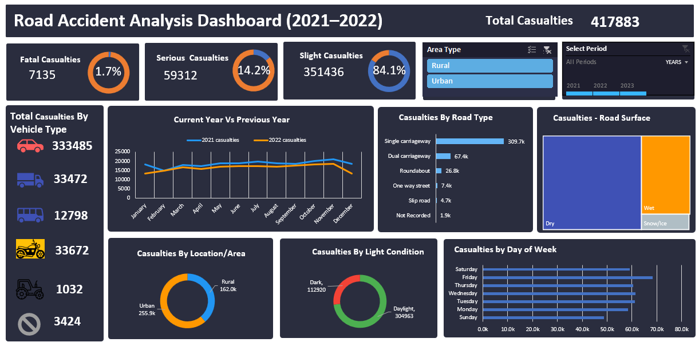

# 🚑 Road Accident Analysis Dashboard (2021–2022)

An interactive Excel dashboard that analyses road accident casualties from 2021–2022 to understand severity, the conditions in which accidents occur, and how casualties change over time.

**Tools:** Microsoft Excel · Pivot Tables · Pivot Charts · Slicers · Data Cleaning

---

## 🎯 Project Objective
Analyse road accident data from 2021–2022 and build an interactive Excel dashboard that shows patterns in casualties, accident severity and contributing conditions. The aim is to turn raw records into insights that could support road safety planning.

## ❓ Business Questions
- How many casualties were recorded, and how severe were they?
- Which vehicle types are involved?
- Which road types and road surface conditions see the most casualties?
- How do urban and rural areas compare?
- How do casualties change month to month?

---

## 📂 Dataset
The dataset contains road accident records for 2021–2022.

| Field | Description |
|---|---|
| Accident date and time | When the accident occurred |
| Vehicle type | Type of vehicle involved |
| Road type | Type of road where the accident occurred |
| Road surface condition | Condition of the road surface |
| Location type | Urban or rural |
| Casualty severity | Fatal, serious or slight |
| Number of casualties | Casualties per record |

**Full dataset:** [Google Drive](https://docs.google.com/spreadsheets/d/1a0N_G0bNHJReJllAGPiVm6PvVYt95p2t/edit?usp=drive_link)

---

## 🔍 Approach
1. Loaded and inspected the raw dataset
2. Cleaned and transformed the data for analysis
3. Built pivot tables to answer each business question
4. Created pivot charts from those tables
5. Added slicers so the dashboard can be filtered interactively
6. Arranged everything into a single dashboard

---

## 📊 Dashboard Features
- Total casualties overview
- Severity breakdown (fatal, serious, slight)
- Vehicle type analysis
- Road type and road surface analysis
- Urban vs rural comparison
- Monthly trend analysis
- Interactive slicers for filtering

---

## 💡 Key Insights
- **417,883** casualties were recorded across 2021–2022: **84.1%** slight (351,436), **14.2%** serious (59,312) and **1.7%** fatal (7,135).
- **Single carriageways** recorded the most casualties (309.7k, about 74%), and **dry road conditions** recorded the most. Both are also the most common conditions, so these counts alone don't show higher risk per mile.
- **Urban areas** had 255.9k casualties (about 61%) against 162.0k in rural areas (about 39%).
- **Daylight** accounted for 304,963 casualties (about 73%) and darkness for 112,920 (about 27%). Darkness has far less traffic, so this doesn't show it is safer.
- **Casualties peaked in November** in both 2021 and 2022. **Friday** was the highest day of the week and **Sunday** the lowest.
---

## ✅ Recommendations
- Prioritise safety reviews on single carriageways, since they account for the most casualties.
- Look into the months with the highest casualties for seasonal or traffic causes, and time awareness campaigns around them.
- Collect traffic volume data so accident **rates** can be compared, not just counts.

---

## ⚠️ Limitations
- The data shows counts, not rates. Traffic volume or distance travelled isn't included, so risk per road type can't be measured.
- The analysis shows patterns, not causes. Many accidents on dry roads don't by themselves show that driver behaviour is the cause.

---

## 🛠 Tools Used
| Tool | Used for |
|---|---|
| Microsoft Excel | Analysis and dashboard |
| Pivot Tables | Summarising data by category and time |
| Pivot Charts | Visualising the summaries |
| Slicers | Interactive filtering |
| Data Cleaning | Preparing the raw records |

---

## 📁 Repository Contents
- [Road_Accident_Analysis_Dashboard.xlsx](https://github.com/sarjanads/Road-Accident-Analysis/blob/main/Road_Accident_Analysis_Dashboard.xlsx): the dashboard
- [Road_Accident_Dashboard.png](Road_Accident_Dashboard.png): dashboard screenshot

---

## 🖱 How to Use the Dashboard
1. Download `Road_Accident_Analysis_Dashboard.xlsx` and open it in Microsoft Excel
2. Go to the dashboard sheet
3. Use the slicers to filter the data
4. The charts update with your selection

*Slicers work best in desktop Excel, not Excel Online or mobile.*

---

## 🧠 What I Learned
- Cleaning and structuring a large dataset before analysing it
- Building linked pivot tables, charts and slicers into one dashboard
- Reading a count carefully instead of assuming it shows risk
- Presenting findings as insights and recommendations, not just charts

---

## 🚀 Future Improvements
- Rebuild the dashboard in **Power BI** with a proper data model
- Query the data with **SQL** to answer the same questions
- Use **Python (Pandas)** for cleaning and extra analysis
- Add traffic volume data to calculate accident rates

---

## 👤 Author
**Sarjana Dhandapani**
MBA (AI & Data Science), RV University · Bengaluru
🔗 [LinkedIn](https://www.linkedin.com/in/sarjanads) · 📧 sarjanadhp@gmail.com
